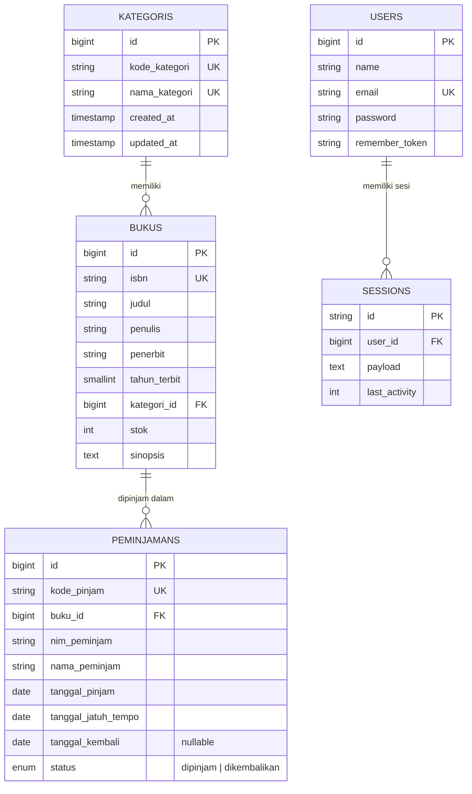
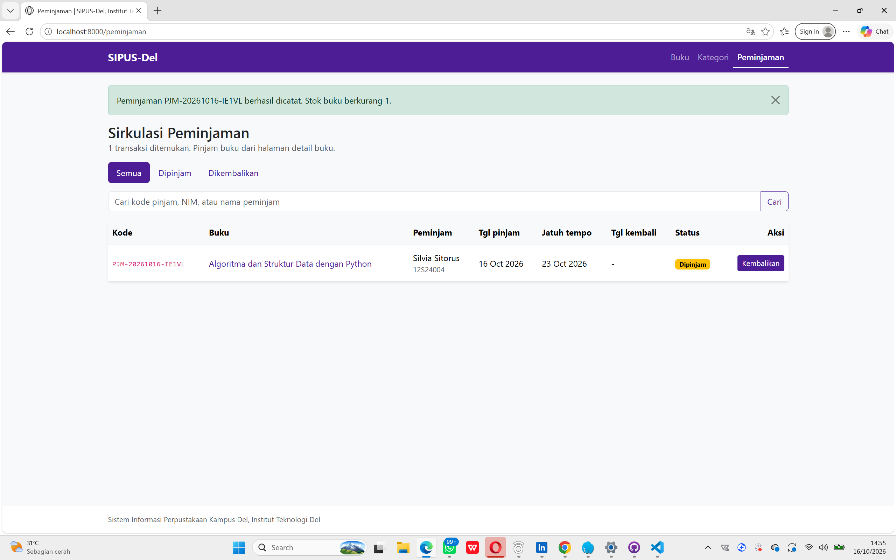
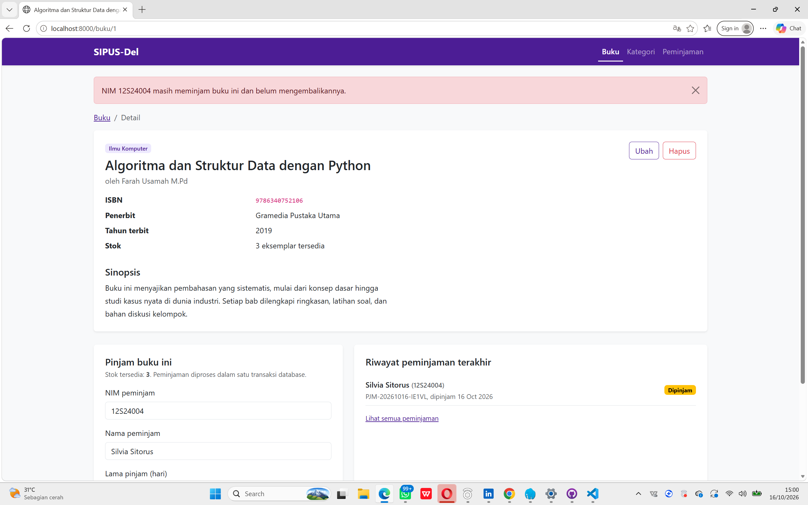
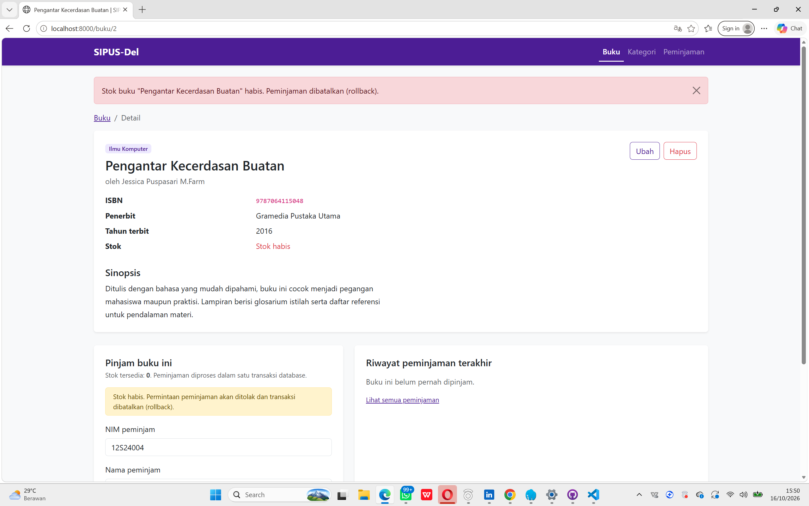
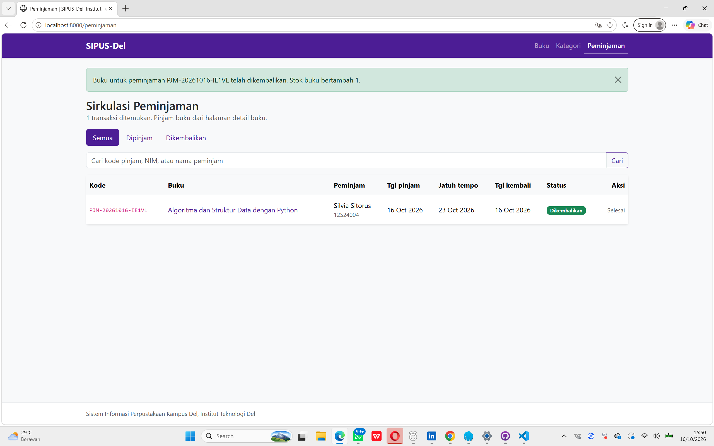
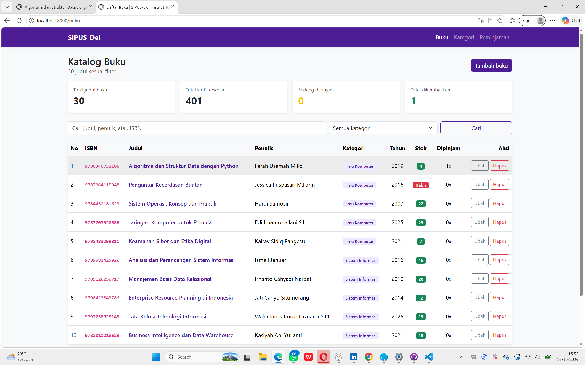
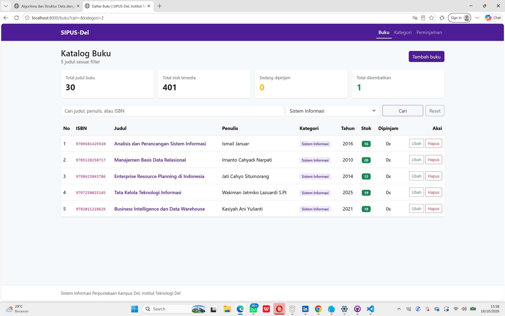
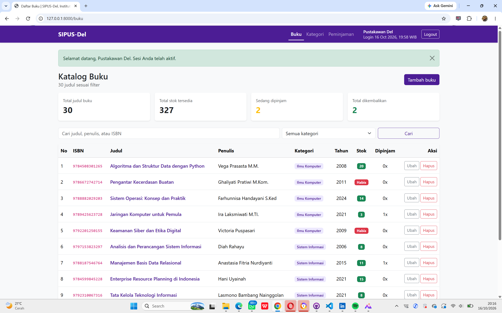
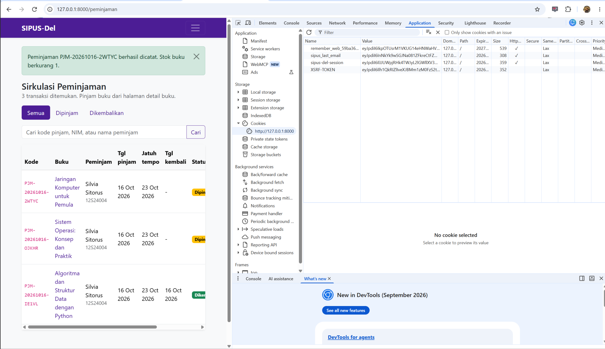

# SIPUS-Del Tahap 2: Transaksi ACID, Query Builder, Session, dan Autentikasi

Tugas Mandiri Praktikum Minggu 6, Pemrograman & Pengujian Web (12S3101), Institut Teknologi Del.
Melanjutkan proyek SIPUS-Del Minggu 5 pada branch **`week6-db-session`**.

| | |
|---|---|
| Nama | **Silvia Eklesiana Sitorus** |
| NIM | **12S24004** |
| Program Studi | Sarjana Sistem Informasi |
| Framework | Laravel 13.34.0, PHP 8.4, MySQL 26.7 (InnoDB) |
| Branch | `week6-db-session` (Minggu 5 tetap utuh di branch `main`) |

## Akun Uji Pustakawan

| Email | Password |
|---|---|
| `pustakawan@del.ac.id` | `password123` |

Akun dibuat otomatis oleh `UserSeeder` saat menjalankan `php artisan migrate:fresh --seed`.

## Fitur Baru Minggu 6

- **Konektivitas MySQL** lewat `.env` (`DB_CONNECTION=mysql`), diverifikasi dengan `php artisan db:show`.
- **Tabel `peminjamans`** dengan foreign key `buku_id` ke `bukus` (`cascadeOnDelete`) dan relasi `Buku hasMany Peminjaman` / `Peminjaman belongsTo Buku`.
- **Peminjaman dan pengembalian buku berbasis ACID**: `DB::transaction()` + `lockForUpdate()`, penolakan stok 0 (rollback), pencegahan NIM ganda, serta penanganan `QueryException` dengan `Log::error()`.
- **Dashboard statistik** dengan Fluent Query Builder `DB::table()`: total judul, total stok (`sum('stok')`), sedang dipinjam, dan total dikembalikan.
- **Katalog bebas N+1**: `Buku::with('kategori')->withCount('peminjamans')`, filter dinamis `when()` (judul/penulis/ISBN dan kategori), serta `paginate()->withQueryString()`.
- **Login pustakawan** dengan `Auth::attempt()`, `session()->regenerate()` saat login, `invalidate()` + `regenerateToken()` saat logout, dan middleware `auth` pada semua rute mutasi.
- **Session state**: waktu login dan peminjam terakhir (mengisi otomatis form pinjam).
- **HTTP Cookie** `sipus_last_email` dengan `Cookie::queue()` untuk mengingat email login selama 7 hari.

## ERD



| Relasi | Foreign key | Aturan hapus |
|---|---|---|
| Kategori -> Buku | `bukus.kategori_id` | `restrictOnDelete` (kategori yang masih punya buku tidak bisa dihapus) |
| Buku -> Peminjaman | `peminjamans.buku_id` | `cascadeOnDelete` (sesuai spesifikasi modul) |

## Instalasi

Prasyarat: PHP 8.3+, Composer, Node.js 20+, dan MySQL 8+ yang sedang berjalan.

```bash
git clone https://github.com/SilviaSitorus12/ppw-2026-week5-12S24004.git
cd ppw-2026-week5-12S24004
git checkout week6-db-session

composer install
cp .env.example .env
php artisan key:generate
```

Sesuaikan koneksi database di `.env` (isi `DB_PASSWORD` sesuai MySQL Anda):

```env
DB_CONNECTION=mysql
DB_HOST=127.0.0.1
DB_PORT=3306
DB_DATABASE=sipus_del
DB_USERNAME=root
DB_PASSWORD=
APP_TIMEZONE=Asia/Jakarta
```

```bash
php artisan migrate:fresh --seed   # jawab "yes" bila diminta membuat database sipus_del
npm install
npm run build
php artisan serve
```

Buka http://127.0.0.1:8000, lalu login di http://127.0.0.1:8000/login.


## Rute dan Proteksi Middleware

| Akses | Rute |
|---|---|
| Publik | `GET /buku`, `GET /buku/{buku}`, `GET /kategori`, `GET /kategori/{kategori}` |
| Tamu (`guest`) | `GET /login`, `POST /login` (dibatasi `throttle:5,1`) |
| Wajib login (`auth`) | Tambah/ubah/hapus buku dan kategori, `GET /peminjaman`, `POST /buku/{id}/pinjam`, `PATCH /peminjaman/{id}/kembali`, `POST /logout` |

Mengakses rute mutasi tanpa login, misalnya `/buku/create`, otomatis dialihkan ke halaman login.


## Transaksi ACID dan Concurrency Locking

Inti `PeminjamanController@pinjam`:

```php
$peminjaman = DB::transaction(function () use ($validated, $id) {
    $buku = Buku::where('id', $id)->lockForUpdate()->firstOrFail();   // SELECT ... FOR UPDATE

    if ($buku->stok < 1) {
        throw new RuntimeException("Stok buku ... habis. Peminjaman dibatalkan (rollback).");
    }

    // tolak bila NIM yang sama masih meminjam buku ini (status 'dipinjam')

    $buku->decrement('stok');
    return $buku->peminjamans()->create([...]);
}, 3);
```

- **Atomicity**: pengurangan stok dan pencatatan peminjaman berhasil bersama atau dibatalkan bersama.
- **Isolation**: `lockForUpdate()` mengunci baris buku di InnoDB. Jika stok tinggal 1 dan dua pustakawan menekan tombol bersamaan, request kedua menunggu, lalu melihat stok 0 dan ditolak. Stok tidak pernah minus.
- **Retry**: argumen `3` mengulang transaksi hingga 3 kali bila terjadi deadlock.
- `QueryException` ditangkap sebelum `RuntimeException` (karena merupakan turunannya) dan dicatat dengan `Log::error()`.

Pengembalian (`kembali`) memakai pola yang sama: kunci baris peminjaman dan buku, ubah status menjadi `dikembalikan`, isi `tanggal_kembali`, lalu `increment('stok')`.

### Bukti pengujian

| No | Skenario | Hasil |
|---|---|---|
| 1 | Pinjam buku dengan stok tersedia | Berhasil, stok berkurang 1 |
| 2 | NIM yang sama meminjam buku yang sama | Ditolak, stok tidak berubah |
| 3 | Pinjam buku dengan stok 0 | Ditolak dan di-rollback, stok tetap 0 |
| 4 | Kembalikan buku | Status `dikembalikan`, stok bertambah 1 |









## Query Builder, withCount, dan Filter Dinamis

```php
$stats = [
    'total_judul'        => DB::table('bukus')->count(),
    'total_stok'         => (int) DB::table('bukus')->sum('stok'),
    'sedang_dipinjam'    => DB::table('peminjamans')->where('status', 'dipinjam')->count(),
    'total_dikembalikan' => DB::table('peminjamans')->where('status', 'dikembalikan')->count(),
];

$bukus = Buku::with('kategori')
    ->withCount('peminjamans')
    ->when($cari !== '', fn ($q) => /* judul, penulis, ISBN */)
    ->when($kategoriId > 0, fn ($q) => $q->where('kategori_id', $kategoriId))
    ->latest()->paginate(10)->withQueryString();
```

`withCount('peminjamans')` menambahkan subquery jumlah peminjaman ke query buku yang sama, dan `with('kategori')` memuat kategori dalam satu query `WHERE id IN (...)`, sehingga katalog bebas N+1. Perbandingan lazy vs eager tetap dapat dibuktikan dengan `php artisan audit:n-plus-one` (21 vs 2 query).





## Session, Cookie, dan Autentikasi

| Bagian | Implementasi |
|---|---|
| Login | `Auth::attempt($credentials, $request->boolean('remember'))` |
| Anti Session Fixation | `$request->session()->regenerate()` setelah login berhasil |
| Logout aman | `Auth::logout()`, `session()->invalidate()`, `session()->regenerateToken()` |
| Session state | `login_timestamp` (tampil di navbar) dan `peminjam_terakhir` (mengisi otomatis form pinjam) |
| Cookie | `Cookie::queue('sipus_last_email', $email, 60 * 24 * 7)`, dibaca kembali di form login |
| Driver sesi | `SESSION_DRIVER=database` (payload di tabel `sessions`, browser hanya menyimpan ID sesi) |




### Audit Cookie (Chrome DevTools > Application > Cookies)

| Cookie | HttpOnly | SameSite | Keterangan |
|---|---|---|---|
| `sipus-del-session` | Ya | Lax | ID sesi terenkripsi |
| `sipus_last_email` | Ya | Lax | Cookie buatan `Cookie::queue()` |
| `remember_web_...` | Ya | Lax | Dibuat saat mencentang "Ingat saya" |
| `XSRF-TOKEN` | Tidak (disengaja) | Lax | Token CSRF untuk dibaca JavaScript |

HttpOnly mencegah cookie dicuri lewat JavaScript (XSS), SameSite=Lax membantu mencegah CSRF, dan seluruh nilai cookie dienkripsi oleh Laravel.



## Seeder

| Seeder | Isi |
|---|---|
| `UserSeeder` | Akun pustakawan uji |
| `KategoriSeeder` | 6 kategori |
| `BukuSeeder` | 30 buku Faker `id_ID`, termasuk sampel stok **0** (*Pengantar Kecerdasan Buatan*) dan stok **1** (*Kalkulus untuk Mahasiswa Teknik*) |
| `PeminjamanSeeder` | 4 transaksi: 2 dipinjam (1 terlambat) dan 2 dikembalikan, dibuat dalam `DB::transaction()` |


## Catatan Teknis

- Proyek memakai **Laravel 13** (modul ditulis untuk Laravel 11). Konsep yang diuji sama; perbedaannya PHP minimal 8.3 dan middleware CSRF bernama `PreventRequestForgery`.
- Model `Peminjaman` menulis `protected $table = 'peminjamans'` secara eksplisit, karena pluralizer bahasa Inggris Laravel akan menebak `peminjamen`.
- Zona waktu aplikasi diatur ke `Asia/Jakarta` agar tanggal pinjam, jatuh tempo, dan waktu login sesuai WIB.

## Riwayat Commit Minggu 6

1. `chore(config): switch database connection to mysql for row-level locking`
2. `feat(migration): create peminjamans table with foreign key to bukus`
3. `feat(transaction): implement ACID book borrowing and return with lockForUpdate`
4. `feat(query-builder): add library analytics dashboard and dynamic search`
5. `feat(auth-session): implement librarian login, session regeneration, and cookies`
6. `fix(config): set application timezone to Asia/Jakarta`
7. `feat(seeder): add librarian account, stock edge cases, and sample loans`
8. `docs: add week 6 readme with erd, acid test evidence, and cookie audit`
