# SIPUS-Del — Tahap 3 (Minggu 9): Web Services SOAP & RESTful API v1

Sistem Informasi Perpustakaan IT Del (SIPUS-Del) tahap 3: analisis kelayakan web services,
simulasi ringkas layanan **SOAP** legacy, serta implementasi **RESTful Web API v1** sebagai
*Service Provider* dan *Service Consumer* pada Laravel.

## Identitas Mahasiswa

| Keterangan | Isi |
|---|---|
| Nama Lengkap | Silvia Eklesiana Sitorus |
| NIM | 12S24004 |
| Kelas | [ISI KELAS] |
| Program Studi | [ISI PROGRAM STUDI] |
| Mata Kuliah | Pemrograman dan Pengujian Aplikasi Web (12S3101) |
| Dosen Pengampu | Chandro Pardede, S.Kom., M.Sc. |
| Branch | `week9-rest-api` |

**Teknologi:** Laravel 13.x (memakai konvensi struktur Laravel 11.x: `bootstrap/app.php`,
`php artisan install:api`), PHP 8.4, Laravel Sanctum 4, MySQL/SQLite, Postman, OpenAPI 3.0.3.

## Daftar Isi

1. [Analisis Kebutuhan & Kelayakan Web Services](#1-analisis-kebutuhan--kelayakan-web-services)
2. [Struktur Kode Minggu 9](#2-struktur-kode-minggu-9)
3. [Katalog Endpoint](#3-katalog-endpoint)
4. [Standar Respons, RFC 7807, & HATEOAS](#4-standar-respons-rfc-7807--hateoas)
5. [Transaksi Sirkulasi ACID](#5-transaksi-sirkulasi-acid)
6. [REST Consumer: OpenLibrary](#6-rest-consumer-openlibrary)
7. [Panduan Instalasi & Pengujian](#7-panduan-instalasi--pengujian)
8. [Galeri Bukti Pengujian](#8-galeri-bukti-pengujian)
9. [Riwayat Commit](#9-riwayat-commit)
10. [Catatan Keamanan](#10-catatan-keamanan)

---

## 1. Analisis Kebutuhan & Kelayakan Web Services

### Kebutuhan Integrasi

| Kebutuhan | Pihak Lain | Gaya Layanan | Peran SIPUS-Del |
|---|---|---|---|
| Cek bebas pustaka saat yudisium | Aplikasi Administrasi Yudisium (legacy, SOAP) | SOAP 1.1 + WSDL | **Provider** |
| Katalog & sirkulasi untuk aplikasi mobile/kiosk | Aplikasi Mobile & Kiosk Perpustakaan | REST JSON `/api/v1` | **Provider** |
| Pengayaan metadata buku (penerbit, halaman) | OpenLibrary REST API | REST JSON | **Consumer** |

SIPUS-Del menjadi **Provider** untuk data yang menjadi domain sahnya (buku, stok, peminjaman).
SIPUS-Del menjadi **Consumer** untuk metadata bibliografis global yang dikelola pihak lain,
karena membangun basis data metadata ISBN sendiri tidak layak dari sisi biaya maupun akurasi.

### Kelayakan

- **Teknis:** Laravel sudah menyediakan `routes/api.php`, Sanctum, API Resource, dan Http Client.
  SOAP disimulasikan tanpa `ext-soap` memakai SimpleXML + XPath `local-name()`, sehingga tidak ada
  dependensi server tambahan.
- **Operasional:** Web Blade tetap melayani pustakawan, sedangkan API melayani mesin. Logika bisnis
  (stok, ACID) sama, hanya lapisan representasinya yang berbeda. Antarmuka Blade Minggu 6 tidak berubah.
- **Keamanan:** API stateless dengan Bearer Token (tanpa session/CSRF), login dibatasi 5 percobaan
  per menit. SOAP dibatasi pada operasi baca dan hanya mengembalikan jumlah pinjaman, bukan data pribadi.

### Mengapa REST (bukan SOAP) untuk Mobile/Kiosk

| Aspek | SOAP | REST (dipilih) |
|---|---|---|
| Ukuran payload | XML verbose (ratusan byte hanya untuk 1 NIM) | JSON ringkas, hemat kuota seluler |
| Semantik HTTP | Hanya POST sebagai terowongan | GET/POST/PUT/PATCH/DELETE + status code jujur |
| Caching | Sulit (semua POST) | GET dapat di-cache (Cache-Control/ETag) |
| Dukungan klien | Butuh library SOAP/stub WSDL | Native di Kotlin/Swift/Flutter/JS |
| Skalabilitas | Bisa stateful | Wajib stateless, mudah di-load-balance (banyak kiosk) |

SOAP tetap dipakai **hanya** untuk Sistem Yudisium karena sistem tersebut legacy dan sudah terikat
kontrak WSDL. Menyesuaikan diri dengan sistem tersebut lebih murah daripada memaksanya bermigrasi.

---

## 2. Struktur Kode Minggu 9

```
app/
├─ Http/Controllers/
│  ├─ Soap/LibrarySoapController.php            # WSDL + SOAP Envelope + SOAP Fault
│  └─ Api/V1/
│     ├─ ApiRootController.php                   # GET /api/v1 (HATEOAS entry point)
│     ├─ AuthTokenController.php                 # login, me, logout (Sanctum)
│     ├─ KategoriApiController.php               # katalog kategori (baca-saja)
│     ├─ BukuApiController.php                   # CRUD buku, PUT vs PATCH, 409/204
│     ├─ PeminjamanApiController.php             # pinjam & kembalikan (ACID)
│     └─ BukuReferensiEksternalController.php    # REST Consumer OpenLibrary
├─ Http/Resources/Api/V1/                        # BukuResource, KategoriResource, PeminjamanResource
├─ Support/ProblemDetails.php                    # pembentuk galat RFC 7807
└─ Traits/ApiResponse.php                        # amplop respons JSON seragam
bootstrap/app.php                                # CSRF except soap/*, handler RFC 7807 global
config/services.php                              # konfigurasi OpenLibrary (dari .env)
routes/api.php · routes/web.php                  # rute REST v1 · rute SOAP
docs/
├─ openapi-sipus-v1.yaml                         # kontrak OpenAPI 3.0.3
├─ SIPUS-Del-APIv1.postman_collection.json       # koleksi uji Postman (46 request)
├─ soap/                                         # contoh amplop SOAP
├─ samples/                                      # contoh body JSON untuk cURL
└─ screenshots/                                  # bukti pengujian
```

---

## 3. Katalog Endpoint

### SOAP (legacy, `routes/web.php`)

| Method | URI | Auth | Deskripsi | Status |
|---|---|---|---|---|
| GET | `/soap/sipus.wsdl` | – | Kontrak WSDL operasi `CheckClearanceStatus` | 200 |
| POST | `/soap/sipus` | – | Cek pinjaman aktif berdasarkan `<nim_peminjam>`, membalas `<active_loans>` & `<is_cleared>` | 200, 500 (`soap:Fault`) |

### REST API v1 (`routes/api.php`, prefix `/api/v1`)

| Method | URI | Auth | Deskripsi | Status |
|---|---|---|---|---|
| GET | `/api/v1` | – | Titik masuk API + `_links` | 200 |
| POST | `/api/v1/auth/login` | – | Menerbitkan Bearer Token (maks. 5×/menit) | 200, 401, 422, 429 |
| GET | `/api/v1/auth/me` | Bearer | Profil pemilik token | 200, 401 |
| POST | `/api/v1/auth/logout` | Bearer | Mencabut token aktif | 200, 401 |
| GET | `/api/v1/kategoris` | – | Daftar kategori + jumlah buku | 200 |
| GET | `/api/v1/kategoris/{id}` | – | Detail kategori | 200, 404 |
| GET | `/api/v1/bukus` | – | Katalog terpaginasi: `search`, `kategori_id`, `tersedia=1`, `sort`, `dir`, `per_page` (1–50) | 200 |
| GET | `/api/v1/bukus/{id}` | – | Detail buku + kategori + riwayat peminjaman | 200, 404 |
| POST | `/api/v1/bukus` | Bearer | Menambah buku | 201 + `Location`, 401, 422 |
| PUT | `/api/v1/bukus/{id}` | Bearer | Full replacement (`sinopsis` yang tidak dikirim menjadi `null`) | 200, 401, 404, 422 |
| PATCH | `/api/v1/bukus/{id}` | Bearer | Partial update (`sometimes\|required`) | 200, 400, 401, 404, 422 |
| DELETE | `/api/v1/bukus/{id}` | Bearer | Menghapus buku | 204, 401, 404, 409 |
| GET | `/api/v1/bukus/{id}/referensi-eksternal` | – | Metadata OpenLibrary berdasarkan ISBN (maks. 30×/menit) | 200, 404, 422, 429, 502, 504 |
| GET | `/api/v1/peminjamans` | Bearer | Daftar peminjaman: `status`, `nim`, `buku_id`, `per_page` | 200, 401, 422 |
| GET | `/api/v1/peminjamans/{id}` | Bearer | Detail peminjaman | 200, 401, 404 |
| POST | `/api/v1/peminjamans` | Bearer | Pinjam buku (ACID) | 201 + `Location`, 401, 404, 409, 422 |
| PATCH | `/api/v1/peminjamans/{id}/kembalikan` | Bearer | Kembalikan buku (ACID) | 200, 401, 404, 409 |

Kontrak lengkap: [`docs/openapi-sipus-v1.yaml`](docs/openapi-sipus-v1.yaml)
(valid di [editor.swagger.io](https://editor.swagger.io)).

---

## 4. Standar Respons, RFC 7807, & HATEOAS

**Respons sukses** (`application/json`):

```json
{ "success": true, "message": "...", "data": { }, "meta": { } }
```

**Respons galat** (`application/problem+json`, IETF RFC 7807), berlaku global untuk seluruh `/api/*`
melalui `bootstrap/app.php` (401, 404, 405, 422, 429, 500):

```json
{
  "type": "http://localhost:8000/docs/errors/validation-failed",
  "title": "Unprocessable Content",
  "status": 422,
  "detail": "Satu atau lebih atribut input yang dikirim tidak memenuhi aturan validasi.",
  "instance": "/api/v1/bukus",
  "errors": { "isbn": ["The isbn has already been taken."] }
}
```

**HATEOAS kontekstual (Richardson Maturity Model Level 3):**

| Resource | Tautan `_links` | Kondisi |
|---|---|---|
| Buku | `self`, `kategori`, `update_full` (PUT), `update_partial` (PATCH), `delete`, `referensi_eksternal` | Selalu |
| Buku | `pinjam_buku` (POST `/api/v1/peminjamans`) | **Hanya jika stok > 0** |
| Peminjaman | `self`, `buku` | Selalu |
| Peminjaman | `kembalikan_buku` (PATCH) | **Hanya jika status = `dipinjam`** |

---

## 5. Transaksi Sirkulasi ACID

`POST /api/v1/peminjamans` dan `PATCH /api/v1/peminjamans/{id}/kembalikan` dibungkus
`DB::transaction()` dengan `lockForUpdate()` pada baris buku (urutan kunci selalu
**buku → peminjaman** untuk mencegah *deadlock*).

Urutan pengecekan peminjaman, **sebelum stok diubah**:

1. Buku tidak ada → **404**
2. NIM yang sama masih meminjam buku yang sama → **409**
3. Stok < 1 → **422** "Stok buku sedang habis"
4. Lolos → stok −1, peminjaman dicatat (`tanggal_jatuh_tempo = hari ini + durasi_hari`) → **201** + `Location`

Karena semua penolakan terjadi sebelum `decrement`, **tidak ada kebocoran stok**. Hal ini diverifikasi
otomatis di Postman: stok buku uji 5 → pinjam 1 kali sukses + 3 kali ditolak (409/422/404) → stok 4 →
dikembalikan → stok 5.

---

## 6. REST Consumer: OpenLibrary

`GET /api/v1/bukus/{id}/referensi-eksternal` memanggil `https://openlibrary.org/isbn/{isbn}.json`
memakai fasad `Http` dengan batas waktu, lalu meringkas judul, penerbit, jumlah halaman, tanggal terbit,
URL, dan sampul. Hasil sukses di-cache 24 jam (`meta.sumber = cache`); `?refresh=1` memaksa panggilan ulang.

| Kondisi | Respons |
|---|---|
| Buku tidak ada di katalog | 404 |
| Buku tanpa ISBN | 422 |
| ISBN tidak terdaftar di OpenLibrary | 404 |
| OpenLibrary tidak merespons dalam batas waktu | 504 Gateway Timeout |
| OpenLibrary tidak dapat dihubungi / galat | 502 Bad Gateway |

Konfigurasi dibaca dari `.env` melalui `config/services.php` (tidak di-*hardcode*):

```
OPENLIBRARY_BASE_URL=https://openlibrary.org
OPENLIBRARY_COVERS_URL=https://covers.openlibrary.org
OPENLIBRARY_TIMEOUT=8
OPENLIBRARY_CONTACT=pustakawan@del.ac.id
```

---

## 7. Panduan Instalasi & Pengujian

### Instalasi

```bash
git clone https://github.com/SilviaSitorus12/ppw-2026-week5-12S24004.git
cd ppw-2026-week5-12S24004
git checkout week9-rest-api

composer install
cp .env.example .env          # PowerShell: copy .env.example .env
php artisan key:generate
# atur koneksi database di .env
php artisan migrate:fresh --seed
php artisan serve
```

**Akun uji (seeder):** `pustakawan@del.ac.id` / `password123`

Data seeder: 6 kategori, 31 buku (termasuk buku **stok 0** "Pengantar Kecerdasan Buatan" dan
"Clean Code" dengan ISBN asli untuk uji OpenLibrary), serta contoh peminjaman
(berstatus `dipinjam` dan `dikembalikan`).

### Pengujian dengan Postman

1. Buka Postman → **Import** → pilih `docs/SIPUS-Del-APIv1.postman_collection.json`.
2. Variabel collection sudah tersedia: `{{base_url}}` = `http://localhost:8000/api/v1`, `{{token}}`.
3. Jalankan request **01. Auth → Login - sukses**: script test otomatis menyimpan `access_token` ke `{{token}}`.
4. Atau jalankan seluruh collection lewat **Run collection** (folder 00–07). Hasil terakhir:
   **95 tests passed, 0 failed, 0 errors**.
5. Folder **08. Latihan GitHub REST API** dijalankan manual dengan mengisi variabel `github_token`
   (kolom *Current Value* saja).

Skenario yang diuji mencakup skenario positif dan negatif: 200, 201 + `Location`, 204, 400, 401,
404, 409, 422, 502/504, serta SOAP 200 dan `soap:Fault` 500.

### Pengujian dengan cURL (contoh)

```powershell
curl.exe -i http://localhost:8000/api/v1/bukus?per_page=3 -H "Accept: application/json"

curl.exe -i -X POST http://localhost:8000/soap/sipus -H "Content-Type: text/xml; charset=utf-8" --data-binary "@docs/soap/request-check-clearance.xml"
```

### Kontrak OpenAPI

Salin isi `docs/openapi-sipus-v1.yaml` ke [editor.swagger.io](https://editor.swagger.io) untuk melihat
dokumentasi interaktif.

---

## 8. Galeri Bukti Pengujian

### (a) SOAP Envelope & SOAP Fault

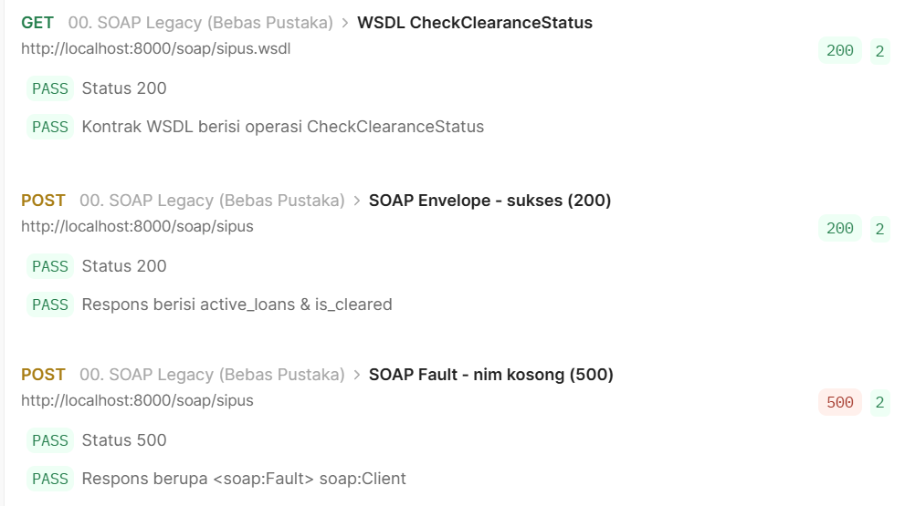

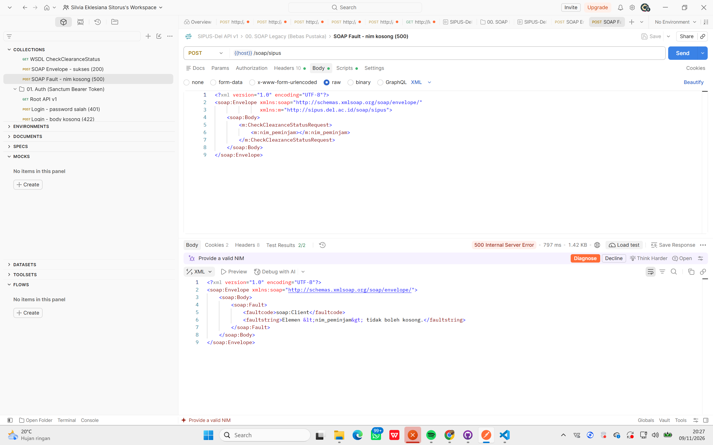

### (b) Login Bearer Token (token disensor)

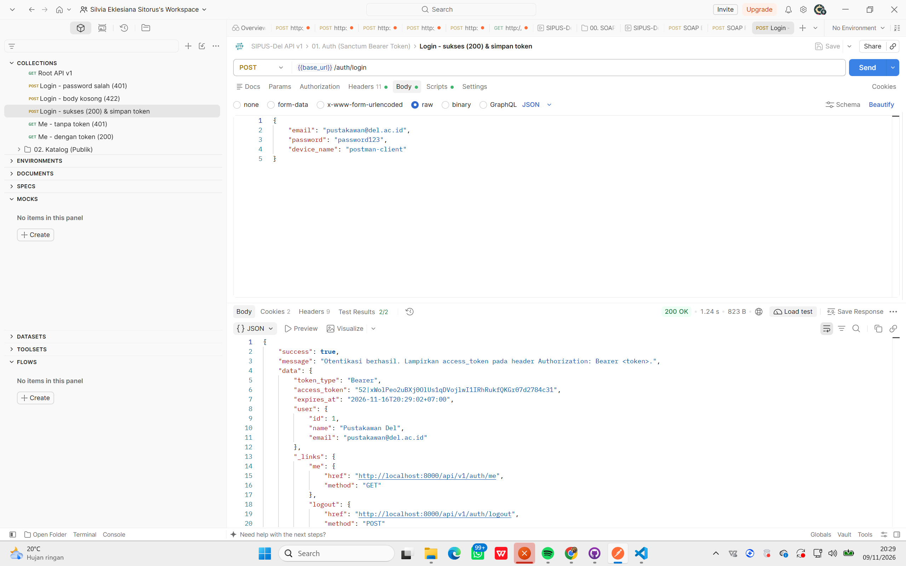

### (c) Katalog Terpaginasi + HATEOAS

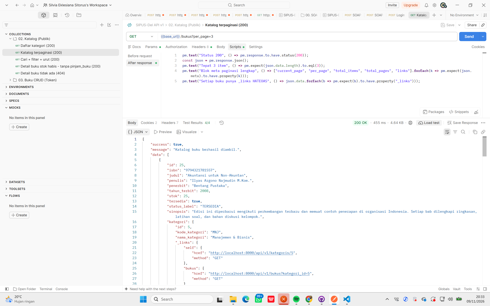

Buku dengan stok 0: tautan `pinjam_buku` tidak muncul.

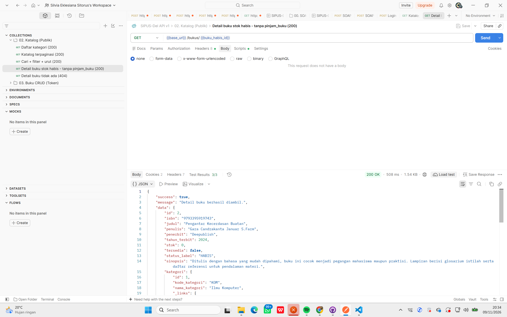

### (d) POST Buku: 201 Created + Header Location

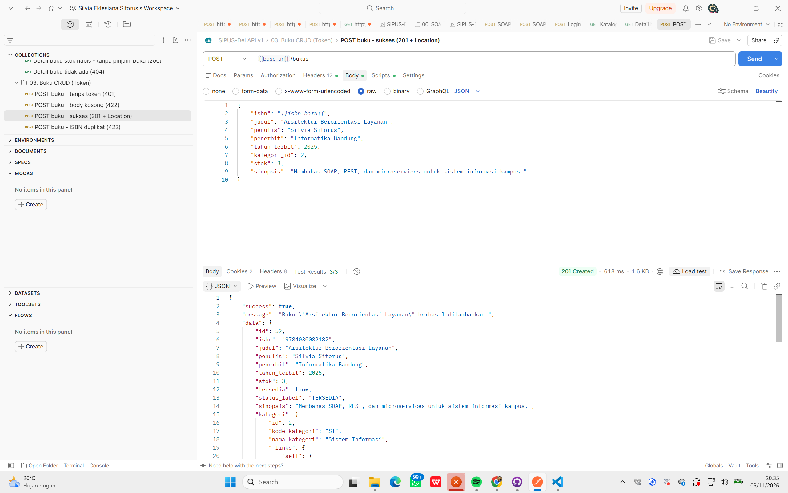

### (e) Perbedaan PUT vs PATCH

PATCH hanya mengubah `stok`, `sinopsis` tetap utuh:

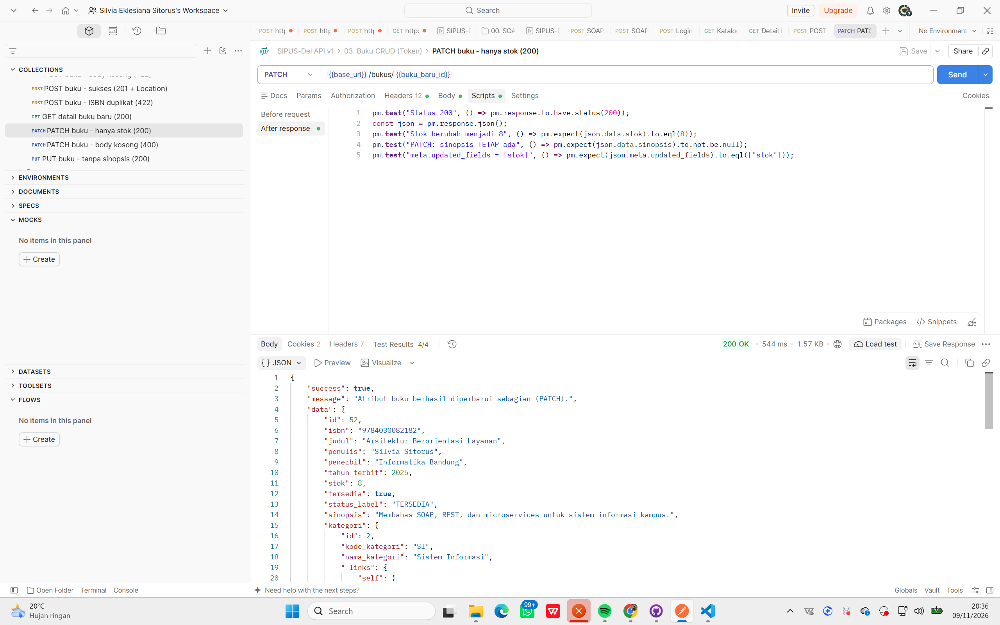

PUT tanpa `sinopsis`, sehingga `sinopsis` di-reset menjadi `null`:

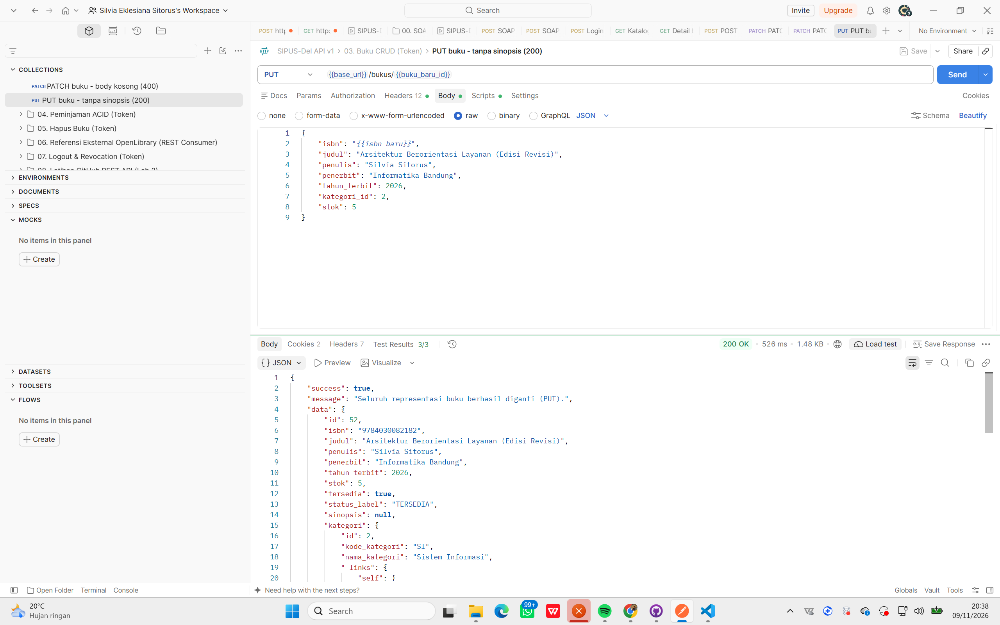

### (f) Peminjaman Sukses & Penolakan (409 / 422)

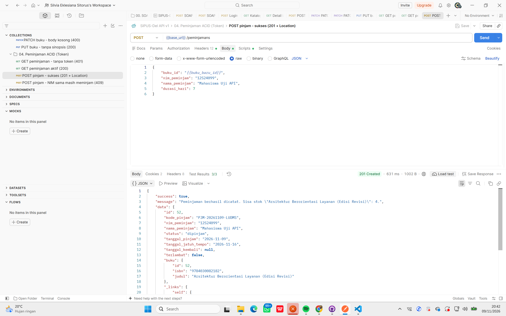

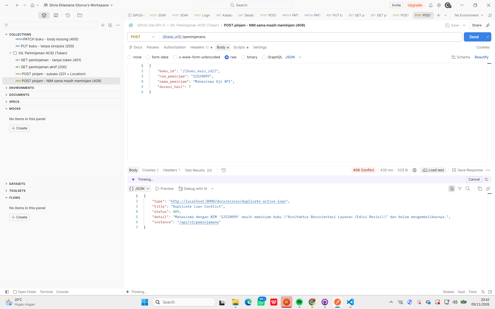

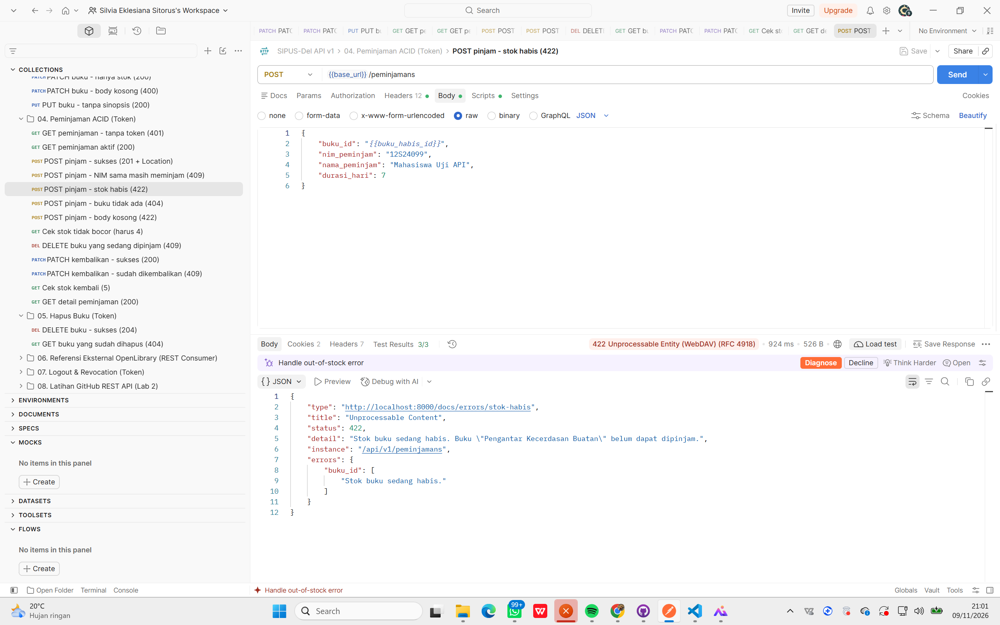

### (g) Latihan GitHub REST API (token disensor)

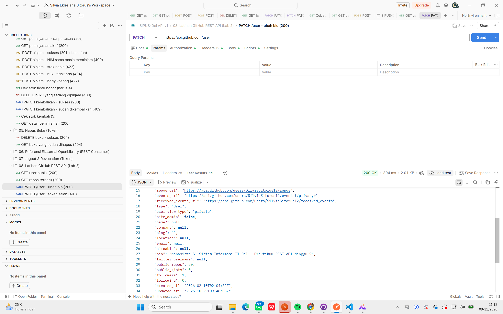

### Ringkasan Postman Runner

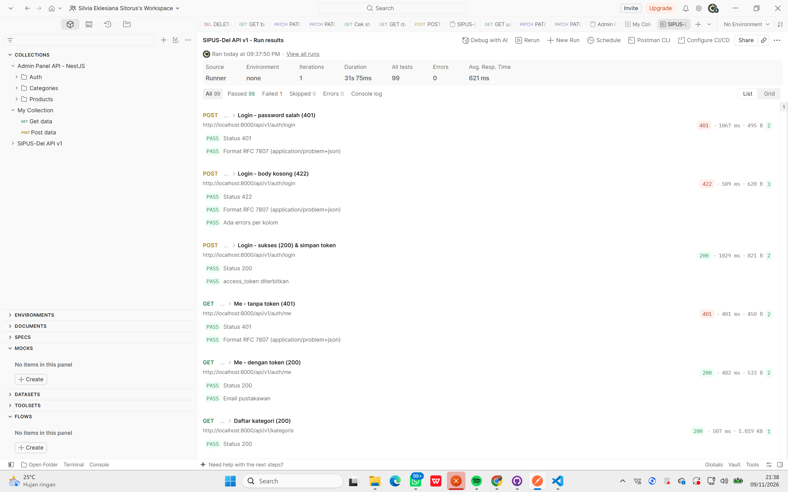

---

## 9. Riwayat Commit

```
feat(soap): add concise LibrarySoapController and WSDL contract for clearance check
feat(api-core): install laravel api routing, ApiResponse trait, and RFC 7807 exception handler
feat(api-auth): implement stateless Sanctum bearer token login and revocation
feat(api-books): build BukuApiController and BukuResource with dynamic HATEOAS links
feat(api-loans): implement ACID book borrowing and return REST endpoints with lockForUpdate
feat(api-consumer): integrate external book metadata lookup via Laravel Http client
docs(contract): add OpenAPI 3.0 specification, Postman collection, and test report in README
```

---

## 10. Catatan Keamanan

- File `.env` tidak di-commit (tercantum di `.gitignore`); `.env.example` hanya berisi nilai non-rahasia.
- Personal Access Token GitHub tidak pernah ditulis di kode, README, maupun collection Postman;
  token pada screenshot disensor dan telah dicabut setelah praktikum.
- Pengecualian CSRF hanya untuk `soap/*`; seluruh form Blade Minggu 6 tetap terlindungi CSRF.

---

# Arsip: README Minggu 6